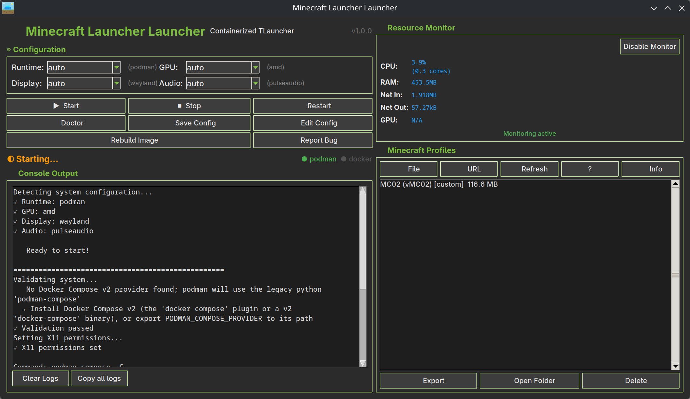

# Minecraft Launcher Launcher


**A launcher for TLauncher** - Run Minecraft safely in an isolated container with full GPU acceleration, audio support, and automatic system detection.



## What Is This?

This project lets you run **Minecraft via TLauncher** inside a container (like a lightweight virtual machine) that:

✅ **Isolates Minecraft** from your main system (safer, cleaner)
✅ **Auto-detects** your GPU, display server, and audio system
✅ **Works out-of-the-box** with NVIDIA/AMD GPUs
✅ **Provides both GUI and CLI** interfaces
✅ **Installs modpacks from a link** (`.mrpack`) and keeps them updated
✅ **Runs on Linux and Windows** (via WSL2)

---

## Three Ways to Run

### 🎮 Option 1: Easy Launcher (Recommended)

**Best for:** Everyone, especially non-technical users

A Python wrapper with graphical interface and automatic detection.

```bash
./minecraft.py          # Opens GUI window
./minecraft.py start    # Or use terminal

# Add to application menu:
./create-shortcut.sh
```

**Features:**

- Double-click to launch
- Auto-detects everything
- One-click start/stop buttons
- Save your preferences
- Real-time log display

👉 **See:** [Quick Start for Linux](#-linux-users) | [Quick Start for Windows](#-windows-users-wsl2)

---

### 🐳 Option 2: Direct Container Commands

**Best for:** Users comfortable with Docker/Podman

Use compose commands directly without the wrapper.

```bash
# Example: Podman + NVIDIA + X11 + Audio
xhost +SI:localuser:$USER
podman compose -f compose.base.yaml -f compose.podman.yaml \
  -f compose.nvidia.yaml -f compose.x11.yaml \
  -f compose.audio-pulseaudio.yaml up
```

👉 **See:** [Manual Compose Guide](RUNBOOK-MANUAL.md)

---

### ⚙️ Option 3: Custom Configuration

**Best for:** Advanced users who want full control

Combine modular compose files for your exact setup.

```bash
# Mix and match:
# - Runtime: podman or docker
# - GPU: nvidia or amd
# - Display: x11 or wayland
# - Audio: pulseaudio or none

docker compose -f compose.base.yaml -f compose.docker.yaml \
  -f compose.amd.yaml -f compose.wayland.yaml \
  -f compose.audio-none.yaml up
```

---

## Quick Start

### 🐧 Linux Users

**1. Install dependencies** (Python 3.10 or newer, podman, PyYAML, Tk):

```bash
# Fedora/RHEL/CentOS
sudo dnf install podman python3-pyyaml python3-tkinter

# Ubuntu/Debian
sudo apt install podman python3-yaml python3-tk

# Arch
sudo pacman -S podman python-yaml tk
```

**2. Clone the repository:**

```bash
# Pick any folder you like; ~/Games is just a suggestion
mkdir -p ~/Games && cd ~/Games
git clone https://github.com/thereisnotime/tlauncher-launcher Minecraft
cd Minecraft
```

**3. Install the Python dependencies.** Two options:

- **System packages (simplest)** — if you installed `python3-pyyaml`/`python3-tk` in step 1,
  you can skip ahead and run `./minecraft.py` directly.
- **Isolated virtualenv** — keeps everything in a local `.venv` without touching system Python.
  This uses [`just`](https://github.com/casey/just) as the task runner (install it with your
  package manager, e.g. `sudo dnf install just` / `sudo apt install just` / `sudo pacman -S just`):

  ```bash
  just install              # creates .venv and installs runtime deps
  ```

**4. Build the container image with Podman:**

```bash
podman build --build-arg JAVA_VERSION=21 -t tlauncher-java:21 .
# or, equivalently (auto-detects podman/docker):
just build
```

The image ships one Java, 21 by default, which only runs TLauncher itself (Minecraft
uses the per-version runtime TLauncher downloads). To use 25 instead, pick it in the
GUI's **Java** dropdown, pass `--java 25`, or build it with `just java=25 build`. Each
version gets its own tag, so only the one you choose takes up space.

The container is capped at 8 GB of RAM by default. Change it with the GUI's **Memory**
dropdown or `--memory 12g` (4g, 6g, 8g, 12g or 16g). That's only the container's ceiling.
Minecraft's own RAM (`-Xmx`) is a TLauncher setting that has to stay below it (with ~1.5 GB
of headroom), or the game gets killed when its heap fills up. `./minecraft.py game-ram`
shows and sets it, Start warns when it doesn't fit, and importing a modpack offers a
sensible value.

**Compose provider.** `podman compose` hands the compose files to a helper program. The
launcher prefers **`podman-compose`** (`sudo dnf install podman-compose` /
`sudo apt install podman-compose`), which talks to podman directly. A Docker Compose
binary (`docker-compose`) also works, but it drives podman through podman's API socket,
so it's only used when that socket is running
(`systemctl --user enable --now podman.socket`). No Docker daemon is involved either way.
`./minecraft.py doctor` tells you which one is in use.

**5. Launch:**

```bash
just run                  # uses the .venv automatically
# or, with system packages: ./minecraft.py
```

👉 **See also:** [Manual Compose Guide](RUNBOOK-MANUAL.md) for direct container commands

---

### 🪟 Windows Users (WSL2 + WSLg)

> **Status: experimental / needs testing.** This path relies on **WSLg**, the GUI +
> audio + GPU layer built into WSL2 on Windows 11 (and recent Windows 10). With WSLg
> you do **not** need VcXsrv/Xming or a manual `DISPLAY` — the launcher auto-detects
> WSL and uses the `compose.wslg.yaml` overlay (display, audio, and GPU in one).

**1. Install/update WSL2 (Windows 11 recommended) with Ubuntu:**

```powershell
wsl --install -d Ubuntu
wsl --update          # ensure WSLg is present
wsl --shutdown        # restart so WSLg initializes
```

**2. Inside the WSL2 (Ubuntu) shell, install a container runtime:**

Either Docker Desktop with WSL integration (<https://docs.docker.com/desktop/wsl/>)
or podman inside the distro (`sudo apt install podman`).

**3. Clone the repository (inside the WSL2 shell):**

```bash
# Clone into your Linux home; do NOT clone onto /mnt/c — it breaks file
# permissions and the bind mounts. ~/Games is just a suggestion.
mkdir -p ~/Games && cd ~/Games
git clone https://github.com/thereisnotime/tlauncher-launcher Minecraft
cd Minecraft
```

**4. Build the image:**

```bash
just build          # auto-detects docker/podman; or: docker build --build-arg JAVA_VERSION=21 -t tlauncher-java:21 .
```

> **Note:** all `just` recipes are bash-based, so run them **inside the WSL2 shell**,
> not from PowerShell/CMD. If you run `just` on native Windows you'll get `sh: not found`;
> install [Git Bash](https://git-scm.com/download/win) or use WSL2 (recommended).

**5. Launch (no X server or DISPLAY setup needed — WSLg handles it):**

```bash
just run            # or: ./minecraft.py
```

Verify detection first with `./minecraft.py doctor` — it should report
`Display: wslg`. If it doesn't, you're likely on an old WSL without WSLg; run
`wsl --update` then `wsl --shutdown` and retry.

**Optional: Create Windows desktop shortcut:**

```powershell
# From PowerShell (run as Administrator):
.\create-shortcut.ps1
```

👉 **See also:** [Manual Compose Guide](RUNBOOK-MANUAL.md) for advanced configuration

---

## How It Works

### Architecture

```text
┌─────────────────────────────────────────┐
│  Your Computer (Host)                   │
│                                         │
│  ┌──────────────────────────────────┐  │
│  │  Container (Isolated)            │  │
│  │                                  │  │
│  │  ├─ TLauncher                   │  │
│  │  ├─ Minecraft                   │  │
│  │  ├─ Java Runtime                │  │
│  │  └─ Your Worlds & Mods          │  │
│  │                                  │  │
│  └──────────────────────────────────┘  │
│         ▲                                │
│         │ Shared:                        │
│         ├─ GPU (for graphics)           │
│         ├─ Audio (for sound)            │
│         └─ Display (for window)         │
└─────────────────────────────────────────┘
```

### File Organization

```text
Minecraft/
├── minecraft.py              # 🚀 Entry point (GUI by default, CLI with a command)
├── gui.py, ui/               # 🖥️  Tk GUI (ui/ holds one mixin per feature area)
├── cli.py                    # ⌨️  Terminal commands
├── core/                     # 🧠 Logic: detection, compose, packs, config, RAM...
├── tests/                    # ✅ pytest suite (`just test`)
├── compose.*.yaml            # 🐳 Container configurations
├── Containerfile             # 📦 Container image recipe
├── entrypoint.sh             # ⚙️  Startup script
│
├── launcher/                 # TLauncher app (auto-downloads)
├── home/                     # 🎮 Your worlds, mods, saves (modpacks: home/versions/<id>/)
└── tlauncher-data/           # 📝 TLauncher settings, cache & logs
```

Your Minecraft data is stored in `./home/` - back this up regularly!

---

## Features

### 🎮 Easy Launcher Features

**GUI Mode** (graphical window):

- Auto-detects your system configuration
- Dropdown menus to override settings
- One-click start/stop/restart buttons
- Real-time log display
- Real-time resource monitoring (CPU, RAM, Network, GPU)
- **Modpacks** - import a `.mrpack` from a link in two clicks, update it when the server
  publishes a new version (see [Modpacks](#-modpacks))
- **Profile management** - Import/export Minecraft versions as ZIP files
- Java (21/25) and container memory settings, plus Minecraft's RAM after modpack imports
- Built-in system validation ("Doctor" button) with log analysis and fix hints
- Save preferences for next launch
- Version and git commit in the title bar, so you know exactly what you're running
- Optional **tray icon** (KDE, GNOME, XFCE, ...): closing the window hides it to the tray,
  and starting the launcher again brings the existing window back (see
  [Tray icon](#-tray-icon))

**CLI Mode** (terminal):

- Rich terminal output with colors and tables
- Interactive confirmation menus
- Commands: start, stop, restart, logs, status, doctor, stats, profiles, game-ram,
  install-compose (`--version` prints the version and commit)
- **Profile management** - List, export, import (incl. `.mrpack`), update, delete
- **Resource monitoring** - Real-time CPU, RAM, Network, GPU stats
- Flag-based overrides: `--runtime docker --gpu amd`
- Works over SSH

### 🖥 Tray icon

Tick **Tray icon** in the Configuration box (it's saved right away, or set `tray: true` in
the config file). While it's on, closing the window hides the launcher to the tray instead
of quitting; the tray menu has Show launcher, Start/Stop Minecraft and Quit launcher. The
game container is never touched by closing or quitting, same as before.

It needs [pystray](https://github.com/moses-palmer/pystray), which is optional:

```bash
sudo apt install python3-pystray gir1.2-ayatanaappindicator3-0.1   # Debian/Ubuntu/Mint
sudo dnf install python3-pystray                                   # Fedora
yay -S python-pystray                                              # Arch (AUR)
pip install pystray pillow                                         # .venv: just install, then this
```

- **KDE Plasma**: works out of the box (the icon registers with the Plasma 6 tray).
- **GNOME**: needs the "AppIndicator and KStatusNotifierItem Support" extension (Ubuntu
  enables it by default). Without a tray host the launcher notices, logs a warning and
  keeps quitting on close, so the window can't get lost.
- **XFCE, Cinnamon, MATE**: use their tray (XEmbed or AppIndicator, whichever pystray
  finds).

Only one launcher window runs at a time: launching it again (menu entry or
`./minecraft.py`) shows the running one, even if it's hidden in the tray.

### 📦 Modpacks

In the **Minecraft Profiles** panel click **🌐 URL**, paste a link to a `.mrpack` (Modrinth
modpack format, what Prism, ATLauncher and the Modrinth App use) and press OK. The launcher:

1. installs the mod loader the pack asks for (NeoForge and Forge run their official
   installer inside the launcher image; Fabric and Quilt use their official metadata),
2. downloads every mod and checks it against the pack's sha512/sha1 hashes,
3. applies the pack's files (configs, a pre-added server list, extra jars),
4. creates a profile whose game folder is `home/versions/<loader-version>/`, so its mods,
   configs and worlds never mix with other versions.

Then start, pick that version in TLauncher and play. Afterwards it offers to give
Minecraft enough RAM for the pack (4 GB, 6 GB for 80+ mods), kept below the container cap.

**Updates.** The launcher remembers where each pack came from. At startup it quietly checks
packs imported from a URL, and **⬆ Update pack** (or `./minecraft.py profiles update`)
reinstalls a pack that changed. Mods the new version dropped are removed. If the update
moves to a new loader version (so a new folder), your worlds, options and configs are
copied across, and the old folder is kept until you delete it.

Also accepted: a plain `.zip` of mods (you pick which installed version gets them),
`.mcprofile.zip` exports from this launcher, and Google Drive / Dropbox / GitHub share
links. Archive paths are validated, so a malicious zip can't write outside the game folder,
and a failed import removes the files it had added.

```bash
./minecraft.py profiles import https://example.com/pack.mrpack
./minecraft.py profiles import mods.zip --into neoforge-21.1.267   # default: shared mods/
./minecraft.py profiles update             # update every imported pack that changed
./minecraft.py game-ram 4096               # Minecraft's RAM in MB
```

### 🔒 Security

- Read-only container filesystem
- No privileged containers
- Isolated from host system
- All capabilities dropped
- Resource limits (CPU, memory, processes)

### 🎯 Auto-Detection

Automatically detects:

- Container runtime (Podman or Docker)
- GPU type (NVIDIA, AMD, or Intel)
- Display server (X11 or Wayland)
- Audio system (PulseAudio/PipeWire or none)

### 🔧 Customization

Override any detection:

- **GUI:** Change dropdowns from "auto" to specific values
- **CLI:** Use flags: `--runtime docker --gpu amd --display wayland`
- **Config file:** Save preferences to `~/.config/minecraft-launcher/`

#### JVM / rendering tuning

These control how the **launcher** (TLauncher) renders. They do not affect the
game. Set them as environment variables before launching, e.g.
`JAVAFX_PRISM=sw ./minecraft.py start`. All have sane defaults that work the
same on X11 and Wayland; override only if you need to.

| Variable | Values | Default | Effect |
|----------|--------|---------|--------|
| `JAVA2D_PIPELINE` | `xrender` / `opengl` / `x11` / `default` | `xrender` | Swing rendering pipeline. `xrender` reduces stutter; `x11` disables acceleration |
| `JAVAFX_PRISM` | `default` / `sw` / `es2` | `default` (hardware) | JavaFX (news/browser panel) pipeline. `sw` = software (slower; only for debugging GPU issues) |
| `JAVA_UI_SCALE` | number (e.g. `1.5`, `2`) | `1` (off) | Scales the Swing UI. TLauncher largely ignores this, so it stays off |
| `JAVA_DISABLE_GRAB` | `true` / `false` | `true` | Stops AWT grabbing the X server for popups |
| `JAVA_PREFER_IPV4` | `true` / `false` | `true` | Avoids IPv6 connection stalls in the container |

Per-display defaults can also be set in the compose overlays
(`compose.x11.yaml`, `compose.wayland.yaml`, `compose.wslg.yaml`).

---

## Platform Support

| Platform        | Container Runtime | Display | Audio      | GPU    | Status          |
|-----------------|-------------------|---------|------------|--------|-----------------|
| Linux (X11)     | Podman, Docker    | ✅      | ✅         | ✅     | Full support    |
| Linux (Wayland) | Podman, Docker    | ✅      | ✅         | ✅     | Full support (via XWayland) |
| Windows (WSL2+WSLg) | Docker, Podman | ✅      | ✅ (WSLg)   | ✅ (d3d12) | Needs testing |
| macOS           | Docker Desktop    | ❌      | ❌         | ❌     | Not supported   |

---

## Feature Comparison

### Core Features

| Feature                          | GUI | CLI | Status |
|----------------------------------|-----|-----|--------|
| Auto-detect system config        | ✅  | ✅  | ✅     |
| Manual config override           | ✅  | ✅  | ✅     |
| Save preferences                 | ✅  | ✅  | ✅     |
| Container start/stop/restart     | ✅  | ✅  | ✅     |
| Real-time logs                   | ✅  | ✅  | ✅     |
| System validation (doctor)       | ✅  | ✅  | ✅     |
| Resource monitoring (CPU/RAM/GPU)| ✅  | ✅  | ✅     |
| Profile import/export            | ✅  | ✅  | ✅     |
| Modpack import (.mrpack, zip)    | ✅  | ✅  | ✅     |
| Modpack updates                  | ✅  | ✅  | ✅     |
| Minecraft RAM setting            | ✅  | ✅  | ✅     |
| Profile management               | ✅  | ✅  | ✅     |
| Existing container detection     | ✅  | ✅  | ✅     |

### Container Runtime Support

| Runtime        | Status      | Notes                              |
|----------------|-------------|------------------------------------|
| Podman         | ✅ Tested   | Rootless mode, recommended         |
| Docker         | ✅ Tested   | Works with both rootful/rootless   |
| Podman Desktop | ⚠️ Untested | Should work, not verified          |
| Docker Desktop | ⚠️ Untested | Should work on WSL2                |

### GPU Support

| GPU Type       | Status      | Notes                                       |
|----------------|-------------|---------------------------------------------|
| NVIDIA         | ✅ Tested   | Full acceleration, stats monitoring         |
| AMD            | ✅ Tested   | Mesa via /dev/dri (compose.amd.yaml)        |
| Intel          | ⚠️ Untested | Mesa via /dev/dri (compose.intel.yaml)      |
| No GPU         | ✅ Works    | Software rendering fallback                 |

### Display Server Support

| Display Server | Status      | Notes                              |
|----------------|-------------|------------------------------------|
| X11            | ✅ Tested   | Full support, auto xhost setup     |
| Wayland        | ✅ Tested   | Runs via XWayland (KDE Plasma)     |
| WSLg (WSL2)    | ⚠️ Untested | Auto-detected on WSL; compose.wslg.yaml |
| X11 forwarding | ✅ Works    | Over SSH with proper DISPLAY setup |

### Audio Support

| Audio System   | Status      | Notes                              |
|----------------|-------------|------------------------------------|
| PulseAudio     | ✅ Tested   | Full audio support                 |
| PipeWire       | ✅ Works    | PulseAudio compatibility mode      |
| No audio       | ✅ Works    | Can run without audio              |

---

## Roadmap

### Planned Features

#### 🔄 Multiple Instance Support

- [ ] Support running multiple TLauncher instances simultaneously
- [ ] Separate container names and data directories per instance
- [ ] GUI selector for switching between instances
- [ ] CLI `--instance` flag for managing specific instances
- [ ] Profile isolation between instances

#### 🧪 Platform Testing

- [ ] **Windows WSL2**: Full testing with Docker Desktop
  - [ ] Display/audio via WSLg
  - [ ] GPU acceleration verification
  - [ ] Desktop shortcut creation (PowerShell script)
- [x] **AMD GPU** on Wayland (KDE Plasma)
- [ ] **Intel GPU**: device passthrough validation
- [ ] **Wayland**: native Wayland instead of XWayland (blocked on OpenJDK)

#### ✨ Enhancements

- [ ] Profile backup scheduler (automatic ZIP exports)
- [x] Mod pack auto-updater integration (`.mrpack` import + updates)
- [ ] Browse and add single mods from Modrinth
- [ ] Server mode (headless dedicated server container)
- [x] Container memory cap and Minecraft RAM settings
- [ ] Per-profile resource limits
- [ ] Dark/light theme toggle for GUI
- [ ] Profile sync to cloud storage (optional)
- [ ] Container health monitoring with alerts
- [x] Log analyzer with fix hints (runs after every exit)
- [ ] Crash report analyzer
- [ ] Automatic log rotation and cleanup
- [ ] Profile templates (modpack presets)

#### 📦 Distribution

- [ ] Pre-built container images on Docker Hub
- [ ] Flatpak packaging for easy installation
- [ ] AppImage for portable Linux deployment
- [ ] Snap package for Ubuntu/derivatives
- [ ] AUR package for Arch Linux
- [ ] Windows installer (with WSL2 setup)

#### 🔧 Technical Improvements

- [ ] Compose file validation on startup
- [ ] Container image auto-update checker
- [ ] Sandboxing improvements (seccomp profiles)
- [ ] Network isolation options
- [ ] Automatic version migration tools
- [ ] Built-in backup/restore functionality
- [ ] Performance profiling mode
- [ ] Multi-language support (i18n)

### Contribution Welcome

Want to help? These areas need testing and feedback:

- **Intel GPU users**: Validate GPU passthrough and performance
- **Windows users**: Test WSL2 setup and report issues
- **Docker users**: Verify Docker-specific configurations
- **Modpack creators**: Test profile import/export with large mod collections

---

## Documentation

### For Users

- **[Quick Start - Linux](#-linux-users)** - Step-by-step Linux installation
- **[Quick Start - Windows](#-windows-users-wsl2)** - Step-by-step Windows (WSL2) installation
- **[RUNBOOK-MANUAL.md](RUNBOOK-MANUAL.md)** - Manual compose commands reference

### For Developers

- **[AGENTS.md](AGENTS.md)** - Conventions and gotchas for anyone (human or AI) changing the code
- **[WRAPPER-STRUCTURE.md](WRAPPER-STRUCTURE.md)** - Launcher architecture and code structure
- **[TLAUNCHER-STRUCTURE.md](TLAUNCHER-STRUCTURE.md)** - Minecraft data organization

#### Development Workflow

This project uses [`just`](https://github.com/casey/just) as its task runner.
Run `just` with no arguments to see all recipes grouped by category (Play / Develop / Maintenance).

```bash
# Create the virtual environment (.venv) on its own (optional;
# install / install-dev create it automatically)
just venv

# Install development dependencies into .venv (includes ruff linter/formatter)
just install-dev

# Format code
just format

# Check formatting without modifying files
just format-check

# Run linter
just lint

# Run linter with auto-fix
just lint-fix

# Run syntax checks + unit tests (pytest, from .venv)
just test

# Syntax check only (no dependencies needed)
just compile

# Build container image (auto-detects podman/docker; override: just build docker)
just build

# Run all CI checks locally
just ci

# Clean up cache files
just clean

# Remove the virtual environment
just clean-venv

# Show all available recipes
just
```

All Python tooling (`ruff`, `pytest`, `py_compile`) runs from `.venv`, so the recipes above
work without installing anything globally.

---

## Troubleshooting

### No display window appears

**Linux:**

```bash
# For X11, grant access:
xhost +SI:localuser:$USER
./minecraft.py start
```

**Windows WSL2:** WSLg provides the display; no X server or `DISPLAY` setup is needed.
`./minecraft.py doctor` should report `Display: wslg`. If not, run `wsl --update` and
`wsl --shutdown` from PowerShell, then try again.

### TLauncher window is tiny on a QHD / HiDPI display

TLauncher's GUI (Java Swing) does not auto-scale on high-DPI screens, and it
largely ignores Java2D scaling, so by default we leave scaling **off** (forcing
it tended to oversize the window without helping). You can still try it:

```bash
JAVA_UI_SCALE=1.5 just run      # 1.5x; use 2 for laptop QHD panels
```

This only affects the TLauncher launcher window, not Minecraft itself (Minecraft has
its own GUI scale setting under Options → Video Settings).

### No GPU acceleration

```bash
# Check detection:
./minecraft.py doctor

# Verify devices exist:
ls -la /dev/nvidia*   # For NVIDIA
ls -la /dev/dri       # For AMD/Intel
```

### No audio

```bash
# Check if audio system is running:
pactl info

# Verify socket exists:
ls -la /run/user/$(id -u)/pulse/native

# Try without audio:
./minecraft.py start --audio none
```

### `failed to connect to the docker API at unix:///run/user/.../podman/podman.sock`

`podman compose` used a `docker-compose` binary, which drives podman through its API
socket, and the socket isn't running. Either install `podman-compose` (preferred; the
launcher then uses it automatically) or start the socket:

```bash
sudo dnf install podman-compose        # or: sudo apt install podman-compose
# or
systemctl --user enable --now podman.socket
```

### Minecraft gets killed / closes without a crash report

Usually the game's heap is larger than the container's memory cap. Check and fix:

```bash
./minecraft.py game-ram          # shows the game RAM and the container cap
./minecraft.py game-ram 4096     # set it (with Minecraft stopped)
```

or raise the GUI's **Memory** setting / `--memory`.

### Container fails to start

```bash
# Run system check:
./minecraft.py doctor

# Check compose files exist:
ls -la compose.*.yaml

# View detailed errors:
./minecraft.py start --yes
```

---

## FAQ

**Q: Do I need to install Minecraft separately?**
A: No! TLauncher downloads and manages Minecraft automatically.

**Q: Where are my worlds saved?**
A: On your host, not inside the container: `./home/saves/` for normal profiles, and
`./home/versions/<version>/saves/` for modpacks and other profiles with their own game folder.

**Q: Can I use mods?**
A: Yes. The easiest way is a modpack: **🌐 URL** in the Minecraft Profiles panel, paste a
`.mrpack` link, OK. See [Modpacks](#-modpacks) for what it does and how updates work. You
can still drop jars into `./home/mods/` by hand, see [TLAUNCHER-STRUCTURE.md](TLAUNCHER-STRUCTURE.md).

**Q: Is this legal?**
A: Yes, TLauncher is a third-party launcher. Own a Minecraft account for full features.

**Q: Does this work with vanilla Minecraft?**
A: Yes, TLauncher supports vanilla Minecraft and modded versions (Forge, NeoForge, Fabric, Quilt).

**Q: Can I run multiple instances?**
A: Yes, copy the entire directory and run each separately.

**Q: How do I update Minecraft?**
A: TLauncher handles updates automatically when you launch it.

**Q: How do I share Minecraft versions between computers?**
A: Use the **Profile Import/Export** feature in GUI or CLI:

**GUI:**

1. Select a profile in the "Minecraft Profiles" panel
2. Click "📤 Export" to save it as a `.mcprofile.zip` file
3. Transfer the ZIP to another computer (or host it at a URL)
4. Click "📥 File" to load a local ZIP, or "🌐 URL" to download and import from a link

**CLI:**

```bash
# List profiles
./minecraft.py profiles list

# Export a profile
./minecraft.py profiles export MC02

# Import a profile, modpack or mods zip from a file...
./minecraft.py profiles import MC02_1.21.mcprofile.zip
# ...or directly from a URL
./minecraft.py profiles import https://example.com/MC02.mcprofile.zip

# Delete a profile
./minecraft.py profiles delete OldVersion
```

The exported ZIP includes the version files plus the profile's mods and configs (the shared
`mods/` and `config/` for profiles without their own game folder).

**Q: How do I monitor resource usage?**
A: Use the **Resource Monitor** in GUI or CLI:

**GUI:** Click "Enable Monitor" in the Resource Monitor panel

**CLI:**

```bash
./minecraft.py stats  # Shows live CPU, RAM, Network, GPU usage
```

**Q: A mod fails to load with `FileWatcher$WatchingException: Failed to watch path`?**
A: This happens when the system runs out of **inotify** instances. Forge mods use file watchers for config hot-reloading, and the default Linux limit (128 instances) is too low for heavily modded packs. Fix it by increasing the limit:

```bash
# Apply immediately (resets on reboot):
sudo sysctl -w fs.inotify.max_user_instances=256

# Make it permanent:
echo 'fs.inotify.max_user_instances=256' | sudo tee /etc/sysctl.d/99-inotify.conf
sudo sysctl --system
```

Then recreate the container and try again.

**Q: What if I don't want the launcher wrapper?**
A: Use compose commands directly - see [RUNBOOK-MANUAL.md](RUNBOOK-MANUAL.md)

---

## Contributing

Found a bug or have a suggestion? Open an issue or pull request!

---

## License

This setup is provided as-is. Minecraft and TLauncher are separate projects with their own licenses.

---

## Credits

- **Minecraft** by Mojang Studios
- **TLauncher** by TLauncher Team
- **Container setup** by this repository's contributors

---

## Getting Help

1. **System check:** Run `./minecraft.py doctor` first (it includes the launcher version)
2. **Check logs:** Look in `./tlauncher-data/logs/`
3. **Platform guides:** [Linux](#-linux-users) | [Windows](#-windows-users-wsl2)
4. **Issues:** Open a GitHub issue with doctor output

---

**Ready to play?** → [Linux Quick Start](#-linux-users) | [Windows Quick Start](#-windows-users-wsl2)
